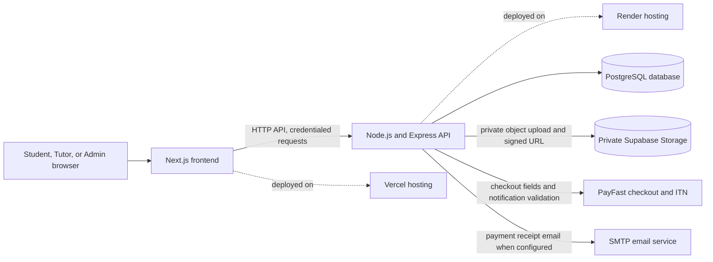
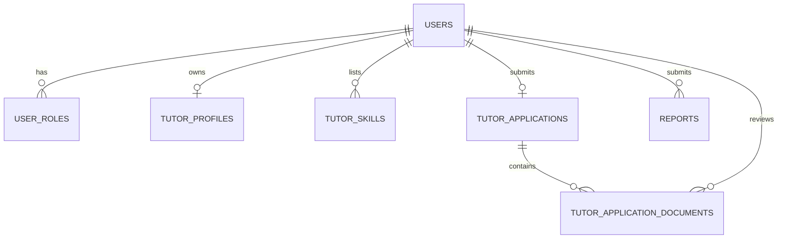

# EasyLearning — Project Documentation

**Project:** EasyLearning — CS Student Skills Tutoring Marketplace

**Document version:** 1.0

**Documentation date:** 13 October 2026
**Status:** Repository-based implementation reference

## Table of Contents

1. [Project Overview](#1-project-overview)
2. [System Architecture](#2-system-architecture)
3. [Technology Stack](#3-technology-stack)
4. [User Roles and Permissions](#4-user-roles-and-permissions)
5. [Functional Requirements and Implementation Status](#5-functional-requirements-and-implementation-status)
6. [Non-Functional Characteristics](#6-non-functional-characteristics)
7. [Database Documentation](#7-database-documentation)
8. [API Documentation](#8-api-documentation)
9. [Security and File Storage](#9-security-and-file-storage)
10. [Installation and Local Setup](#10-installation-and-local-setup)
11. [Deployment Guide](#11-deployment-guide)
12. [Limitations and Future Improvements](#12-limitations-and-future-improvements)
13. [Glossary and References](#13-glossary-and-references)

## 1. Project Overview

### 1.1 Purpose

EasyLearning is a peer-to-peer tutoring marketplace intended to help Computer Science students find other students who can tutor them in a subject. Its product concept allows a student to seek help and, after an application is approved, also provide tutoring.

### 1.2 Problem and proposed solution

Students who are confident in a subject and students who are having difficulty may not readily find one another. EasyLearning provides tutor discovery, student-to-tutor requests, tutor approval, and payment support for accepted sessions.

### 1.3 Target users and benefits

| User | Intended use | Potential benefit |
|---|---|---|
| Student | Find tutors, request help, manage profile, submit support reports | Discover peer support and track tutoring requests |
| Tutor | Apply for tutor access, maintain a tutor profile, respond to session requests | Offer peer tutoring after approval |
| Administrator | Review tutor applications and documents, view platform data, manage reports | Moderate tutor access and resolve user-reported problems |

### 1.4 Scope

The repository contains public pages, authentication and role management, tutor discovery and profiles, tutor applications with private academic documents, session requests, PayFast payment handling, admin dashboards, and problem reporting. Messaging, calendar booking, session completion, ratings, peer skill endorsements, and a general email-verification flow are not present as complete implemented modules in the inspected API.

## 2. System Architecture

The browser frontend calls the Express API using `NEXT_PUBLIC_API_URL`; the backend reads and writes PostgreSQL through `pg`. Tutor application documents and optional report attachments are stored in private Supabase Storage. The PayFast integration creates checkout fields server-side and accepts provider notifications for server-side verification. The repository README describes Vercel frontend and Render API origins; their current operational health was not independently verified.



## 3. Technology Stack

| Technology/service | Purpose | Repository location | Implementation notes |
|---|---|---|---|
| Next.js 16, React 19 | Web frontend and App Router pages | `client/` | Client pages use React state and fetch the API |
| Tailwind CSS 4 | Frontend styling | `client/` | Styling is integrated with the existing design system |
| Node.js | JavaScript runtime | `server/` | Backend package uses CommonJS |
| Express 5 | HTTP API and middleware | `server/index.js`, `server/routes/` | Routers are mounted under `/api` prefixes |
| PostgreSQL and `pg` | Persistent application data | `server/db.js` | Connection is read from `DATABASE_URL`; README identifies Neon |
| `bcryptjs` | Password hashing and comparison | `server/routes/auth.js`, admin bootstrap | Registration hashes passwords; login compares the submitted password |
| `jsonwebtoken` | Signed authentication tokens | `server/routes/auth.js`, `server/middleware/auth.js` | Token is set in an HttpOnly cookie and middleware also accepts a bearer token |
| Multer | Multipart upload parsing | `server/services/privateDocuments.js` | In-memory uploads with explicit size and file-count limits |
| Supabase Storage SDK | Private tutor documents and report attachments | `server/services/privateDocuments.js` | Backend-only secret key; objects are not public |
| PayFast | Session checkout and payment notification | `server/services/payfast.js`, `server/routes/payments.js` | Requires provider and callback configuration |
| Nodemailer / SMTP | Payment receipt email | `server/services/receiptEmail.js` | Receipt email is attempted after verified payment; SMTP is external configuration |
| Node.js built-in test runner | Backend tests | `server/test/` | Executed with `npm test` in `server/` |
| Vercel / Render | Documented frontend/backend hosting | `README.md` | Repository documents these targets; no deployment was performed for this document |

## 4. User Roles and Permissions

### 4.1 Roles

Roles are stored in `user_roles` and may include more than one applicable role. The supported role values are `STUDENT`, `TUTOR`, and `ADMIN`.

| Role | Typical permissions |
|---|---|
| `STUDENT` | Own profile, own tutoring requests, report submission/history, tutor application, payment initialization/status/receipt |
| `TUTOR` | Tutor profile and incoming session requests; may also retain `STUDENT` |
| `ADMIN` | Admin dashboard and tutor application/report queue operations; provisioned using a trusted server command |

The authentication middleware derives effective roles from the database. `TUTOR` is effective only while an approved tutor application exists. The UI redirects users between dashboards, but API middleware is the authorization boundary.

### 4.2 Registration, login, and logout

- Public registration accepts a student or tutor-intent selection, but public registration creates the `STUDENT` role; tutor access requires an approved application.
- Registration validates a university/email pairing using the repository university configuration, hashes the password with bcrypt, and issues an authentication cookie.
- Login checks the stored password hash, obtains effective roles, and issues the same cookie.
- `GET /api/auth/me` returns the currently authenticated profile and effective roles.
- Logout clears the cookie. The logout route itself does not require authentication.
- The cookie is HttpOnly, expires after seven days, and uses `Secure` and `SameSite=None` in production; non-production uses `SameSite=Lax`.
- A fallback JWT signing secret exists in source when `JWT_SECRET` is absent. Production must supply a strong private secret; this fallback is a deployment risk.

### 4.3 Tutor application and approval

An authenticated student submits an application and two academic documents. Administrators review the registration proof and academic record individually. Application approval is blocked until both documents are `VERIFIED`; approval grants the `TUTOR` role while retaining the user's `STUDENT` role. Public registration does not grant admin access. The dedicated admin account is provisioned by `npm run admin:bootstrap` with server-only `ADMIN_PASSWORD`.

### 4.4 Dashboard protection

Dashboard pages check the current account through the API and redirect users whose roles do not match. Admin-only and role-specific API routes separately enforce roles on the server. Client-side visibility alone must not be considered authorization.

## 5. Functional Requirements and Implementation Status

Status labels in this section describe source presence and repository test evidence, not a live production certification.

| Module | Current implementation | Status/evidence |
|---|---|---|
| Public site | Home page, navbar/footer, tutor listing and tutor profile pages | Implemented in `client/app/`; API-backed tutor retrieval exists |
| Authentication | Registration, login, current-user retrieval, logout, profile update, legacy tutor-upgrade endpoint | Implemented; authentication and registration covered by backend tests |
| Student dashboard | Profile editing, session request history, tutor discovery/application status and payment entry points | Implemented in `client/app/dashboard/student/page.tsx`; backend request/payment tests exist |
| Tutor dashboard | Tutor profile management and incoming request response controls | Implemented in `client/app/dashboard/tutor/page.tsx`; session request route tests exist |
| Tutor discovery | Search/filter by text, subject, and university; approved tutor profile lookup | Implemented in `server/routes/tutors.js` and client tutor pages |
| Tutor application | Application submission, subject list, own application, administrator list/review | Implemented; route tests exercise application workflow |
| Academic documents | Registration proof and academic record, private upload/download, independent review, rejected-document replacement | Implemented; PDF/JPG/JPEG/PNG, 5 MiB each; storage configuration required; mocked-storage tests exist |
| Admin dashboard | Overview, users, approved tutors, applications, payment records, report review section | Implemented; live data requires API/database availability |
| Session requests | Student creates and lists requests; tutor lists incoming requests and accepts/declines | Implemented; tutor response uses a `PATCH` API route |
| Payments | Student initializes PayFast checkout for accepted sessions, retrieves payment status and receipts; unauthenticated provider callback verifies notification | Implemented in source; PayFast/DB configuration and provider reachability required |
| Payment receipt email | Sends an email after verified payment | Implemented but depends on SMTP configuration; email failure does not reverse verified payment |
| Problem reports | Submission, own report history, admin queue/filters/status/response; optional private attachment | Implemented in report API and client; report tests use mocked database and storage |
| Email verification | No separate email verification endpoint or end-user verification workflow identified | Not implemented as a complete feature |
| Messaging, calendar booking/reminders | No routes/pages implementing these workflows identified | Planned or not implemented |
| Reviews, ratings, skill endorsements | No corresponding API workflow identified | Planned or not implemented |

## 6. Non-Functional Characteristics

| Area | Evidence and limitation |
|---|---|
| Authentication | Bcrypt password hashes and signed tokens are used. JWT fallback secret must not be relied on for production. |
| Authorization | API middleware enforces roles; report/documents additionally check ownership before returning private data or a signed URL. |
| Database access | Route SQL uses parameterized values for user input in the reviewed routes. Runtime database availability depends on `DATABASE_URL` and DNS/network reachability. |
| Input validation | Routes validate selected required fields, identifiers, enums, lengths, and upload limits. Validation is route-specific and should not be presumed uniform across every endpoint. |
| File handling | Uploads are held in memory, restricted by MIME/extension and file signature, capped at 5 MiB per file, and placed in private storage. |
| Error handling | Many routes return generic errors; some older auth/profile and public tutor handlers include driver exception messages in error responses. Avoid exposing such responses to end users and consider tightening those paths separately. |
| Availability | Startup retries selected transient database connection errors a bounded number of times. This cannot resolve a missing or stale database hostname. |
| Performance | PostgreSQL indexes exist for report lookups; no load/performance test results were found in the repository review. |
| Privacy | Password hashes are selected only for server-side login comparison in the inspected route, but some public tutor responses include tutor email addresses. Review disclosure requirements before public launch. |
| Verification evidence | The server test suite was executed on 13 October 2026: 69 tests passed, 0 failed. This does not verify production services or the browser flows end to end. |

## 7. Database Documentation

The schema is assembled from `server/schema.sql` and runtime initializers. Authentication initializes `users` and `user_roles`; tutor application service initializes tutor profiles, skills, applications and documents; report service initializes reports and indexes. There is no separate versioned migration framework or migration command.

### 7.1 Confirmed table definitions

Types below are PostgreSQL types from the checked-in schema or runtime DDL. Runtime-added `university_name` on `tutor_applications` is included.

#### `users`

| Column | Type | Constraints/notes |
|---|---|---|
| `id` | `SERIAL` | Primary key |
| `first_name` | `VARCHAR(100)` | Not null |
| `last_name` | `VARCHAR(100)` | Not null |
| `university` | `VARCHAR(150)` | Not null |
| `email` | `VARCHAR(255)` | Unique, not null |
| `password_hash` | `VARCHAR(255)` | Not null; never return to browser |
| `created_at` | `TIMESTAMP WITH TIME ZONE` | Defaults to current timestamp |
| `role` | Legacy column, if present | Auth initializer migrates existing legacy role data and drops its `NOT NULL` requirement; not declared in the base `CREATE TABLE` here |

#### `user_roles`

| Column | Type | Constraints/notes |
|---|---|---|
| `user_id` | `INTEGER` | Foreign key to `users.id`, cascade on user deletion |
| `role` | `VARCHAR(20)` | Check: `STUDENT`, `TUTOR`, or `ADMIN` |
| `(user_id, role)` | — | Composite primary key |

#### `tutor_profiles`

| Column | Type | Constraints/notes |
|---|---|---|
| `user_id` | `INTEGER` | Primary key and foreign key to `users.id`, cascade on deletion |
| `headline` | `VARCHAR(255)` | Default headline |
| `bio` | `TEXT` | Default description |
| `hourly_rate` | `NUMERIC(10,2)` | Not null; default `180.00` |
| `created_at` | `TIMESTAMP WITH TIME ZONE` | Defaults to current timestamp |

#### `tutor_skills`

| Column | Type | Constraints/notes |
|---|---|---|
| `id` | `SERIAL` | Primary key |
| `user_id` | `INTEGER` | Foreign key to `users.id`, cascade on deletion |
| `skill_name` | `VARCHAR(100)` | Not null |
| `(user_id, skill_name)` | — | Unique pair |

#### `tutor_applications`

| Column | Type | Constraints/notes |
|---|---|---|
| `id` | `SERIAL` | Primary key |
| `user_id` | `INTEGER` | Unique, not-null foreign key to `users.id`, cascade on deletion |
| `student_number` | `VARCHAR(80)` | Optional |
| `programme` | `VARCHAR(200)` | Optional |
| `year_of_study` | `SMALLINT` | Optional; check 1–12 |
| `motivation` | `TEXT` | Optional |
| `experience` | `TEXT` | Optional |
| `skills_description` | `TEXT` | Optional |
| `subjects` | `TEXT[]` | Not null; defaults to empty array |
| `proposed_hourly_rate` | `NUMERIC(10,2)` | Check > 0 when set |
| `status` | `VARCHAR(20)` | Not null; `PENDING`, `APPROVED`, `REJECTED` |
| `application_source` | `VARCHAR(20)` | Not null; `USER` or `LEGACY` |
| `university_name` | `VARCHAR(200)` | Added with `ALTER TABLE ... ADD COLUMN IF NOT EXISTS` |
| `email_verified_at` | `TIMESTAMP WITH TIME ZONE` | Optional timestamp; no end-user verification flow identified |
| `submitted_at` | `TIMESTAMP WITH TIME ZONE` | Optional |
| `reviewed_at` | `TIMESTAMP WITH TIME ZONE` | Optional |
| `reviewed_by` | `INTEGER` | Optional foreign key to `users.id`, set null on deletion |
| `rejection_reason` | `TEXT` | Optional |
| `created_at`, `updated_at` | `TIMESTAMP WITH TIME ZONE` | Not null; default current timestamp |

#### `tutor_application_documents`

| Column | Type | Constraints/notes |
|---|---|---|
| `id` | `SERIAL` | Primary key |
| `application_id` | `INTEGER` | Foreign key to `tutor_applications.id`, cascade on deletion |
| `document_type` | `VARCHAR(30)` | `registration` or `academicRecord` |
| `storage_key` | `VARCHAR(255)` | Unique opaque private-storage reference |
| `original_name` | `VARCHAR(255)` | Not null |
| `mime_type` | `VARCHAR(100)` | PDF, JPEG, or PNG |
| `size_bytes` | `INTEGER` | Greater than zero and at most 5,242,880 |
| `status` | `VARCHAR(20)` | `PENDING`, `VERIFIED`, or `REJECTED` |
| `rejection_reason` | `TEXT` | Optional |
| `uploaded_at` | `TIMESTAMP WITH TIME ZONE` | Not null; defaults to current timestamp |
| `reviewed_at` | `TIMESTAMP WITH TIME ZONE` | Optional |
| `reviewed_by` | `INTEGER` | Optional foreign key to `users.id`, set null on deletion |
| `(application_id, document_type)` | — | Unique pair |

#### `reports`

| Column | Type | Constraints/notes |
|---|---|---|
| `id` | `SERIAL` | Primary key |
| `reporter_id` | `INTEGER` | Not-null foreign key to `users.id`, cascade on deletion |
| `reporter_roles` | `VARCHAR(20)[]` | Non-empty; values restricted to supported roles |
| `category` | `VARCHAR(80)` | One of seven report categories |
| `subject` | `VARCHAR(160)` | Not null; trimmed length must be positive |
| `description` | `VARCHAR(5000)` | Not null; trimmed length must be positive |
| `attachment_storage_key` | `VARCHAR(255)` | Optional, unique opaque key |
| `attachment_original_name` | `VARCHAR(255)` | Optional; attachment metadata columns are constrained as an all-or-none group |
| `attachment_mime_type` | `VARCHAR(100)` | Optional PDF, JPEG, or PNG |
| `attachment_size_bytes` | `INTEGER` | Optional; 1 to 5,242,880 |
| `status` | `VARCHAR(20)` | Defaults to `OPEN`; `OPEN`, `IN_REVIEW`, `RESOLVED`, `CLOSED` |
| `admin_response` | `TEXT` | Optional user-visible response |
| `created_at`, `updated_at` | `TIMESTAMP WITH TIME ZONE` | Not null; defaults to current timestamp |

Report indexes: `(reporter_id, created_at DESC, id DESC)` and `(status, category, created_at DESC, id DESC)`.

### 7.2 Referenced but not defined in checked-in DDL

The session-request and payment routes query and mutate `session_requests` and `payments`. Neither table's `CREATE TABLE` definition was found in `server/schema.sql` or the runtime JavaScript initializers inspected. The code therefore assumes these tables already exist in the connected database. Their complete columns, constraints, and migration/provisioning procedure cannot be confirmed from this repository; obtain and document the authoritative database DDL before reproducing a production database from scratch.

### 7.3 Relationships



The diagram covers only relationships established by confirmed table constraints. Session/payment relationships are used in route queries but cannot be fully diagrammed from the DDL present here.

## 8. API Documentation

All routes below are mounted by `server/index.js`. Request and response field summaries are intentionally concise; route source is authoritative. Unless stated otherwise, JSON routes use `Content-Type: application/json`. Browser requests typically use credentialed cookies; authentication middleware also accepts bearer-token authentication.

### 8.1 Authentication: `/api/auth`

| Method and path | Auth/permission | Inputs and behavior | Successful result; notable errors |
|---|---|---|---|
| `POST /api/auth/register` | Public | `firstName`, `lastName`, `university`, `email`, `password`; optional `role` intent. Validates university/email pairing; public account begins as `STUDENT`. | `201` with safe user profile and roles, registration message, auth cookie. `400` invalid/reserved/duplicate data; `500` registration/database failure. |
| `POST /api/auth/login` | Public | `email`, `password` | `200` safe profile, roles, auth cookie. `400` missing fields; `401` invalid credentials; `503` database connection/DNS failure; generic `500` otherwise. |
| `GET /api/auth/me` | Authenticated | Cookie or bearer token | `200` user profile and effective roles; `401` invalid/missing token; `404` missing profile; `500` lookup failure. |
| `PUT /api/auth/me` | Authenticated | `firstName`, `lastName`, `university`, `email` | `200` updated profile and roles, refreshed cookie; `400` invalid values, `404` profile missing, `409` email conflict. |
| `POST /api/auth/upgrade-tutor` | Authenticated | No meaningful user-supplied fields | `200` if Tutor role already approved; otherwise `409` with application path. Does not grant Tutor access. |
| `POST /api/auth/logout` | Public cookie-clearing action | No body required | `200` logout message; clears auth cookie. |

### 8.2 Tutor discovery/profile: `/api/tutors`

| Method and path | Auth/permission | Inputs and behavior | Successful result; notable errors |
|---|---|---|---|
| `GET /api/tutors` | Public | Optional query `search`, `subject`, `university` | `200 { tutors: [...] }`; only approved tutors are selected. `500` listing failure. Tutor response includes profile, subjects, email, and role labels. |
| `GET /api/tutors/profile` | Authenticated `TUTOR` | No parameters | `200 { tutor: ... }`; `401/403` auth/role failure; `404` missing profile; `500` retrieval failure. |
| `GET /api/tutors/:id` | Public | Tutor ID path parameter | `200 { tutor: ... }` for approved tutor; `400` invalid ID; `404` profile not found; `500` lookup failure. |
| `PUT /api/tutors/profile` | Authenticated `TUTOR` | `headline`, `bio`, positive `hourlyRate`, optional `subjects` array | `200` update message; `400` invalid rate; `500` update failure. |

### 8.3 Tutor applications/documents: `/api/tutor-applications`

| Method and path | Auth/permission | Inputs and behavior | Successful result; notable errors |
|---|---|---|---|
| `GET /api/tutor-applications/subjects` | Authenticated | None | `200 { subjects: [...] }`; `500` lookup failure. |
| `GET /api/tutor-applications/me` | Authenticated | None | `200` applicant/application and safe document metadata; `application` is null when absent. `500` retrieval failure. |
| `POST /api/tutor-applications` | Authenticated `STUDENT`; private storage required | Multipart `universityName`, `programme`, `yearOfStudy`, `motivation`, `skillsDescription`, `subjects`, `proposedHourlyRate`; optional `studentNumber`, `experience`; exactly one each `registration`, `academicRecord`. PDF/JPG/JPEG/PNG, max 5 MiB each. | `201 { application: ... }`; `400` validation/missing documents, `409` already submitted/approved, `415` file content mismatch, `503` storage unavailable, `500` failure. |
| `PUT /api/tutor-applications/me/documents/:type` | Authenticated `STUDENT`; private storage required | Multipart `document`; `:type` is `registration` or `academicRecord` | `200 { document: ... }`, new status `PENDING`; `400` invalid type, `404` no pending application, `409` document is not rejected, `415/503/500` upload/storage errors. |
| `GET /api/tutor-applications/:id/documents/:type` | Authenticated; owner or `ADMIN`; storage required | Application ID and document type | `302` to five-minute signed URL after authorization; `400` invalid ID/type, `404` unavailable/not owned, `503` storage unconfigured, `500` storage error. |
| `PATCH /api/tutor-applications/:id/documents/:type/review` | Authenticated `ADMIN`; storage required | JSON `status: VERIFIED` or `REJECTED`; rejection requires `rejectionReason` | `200 { document: ... }`; `400` invalid values; `403` admin reviewing own document; `404` application/document missing; `409` already rejected; `503/500` errors. |
| `GET /api/tutor-applications` | Authenticated `ADMIN` | None | `200 { applications: [...] }` with document metadata; `500` retrieval failure. |
| `PATCH /api/tutor-applications/:id/review` | Authenticated `ADMIN`; private storage required for approval | JSON status `APPROVED` or `REJECTED`; rejection requires reason | `200 { application: ... }`; `400` invalid ID/status/reason; `404` missing/unsubmitted; `409` already reviewed or required documents unverified; `503` private storage unavailable; `500` failure. |

### 8.4 Session requests: `/api/session-requests`

| Method and path | Auth/permission | Inputs and behavior | Successful result; notable errors |
|---|---|---|---|
| `GET /api/session-requests/mine` | Authenticated `STUDENT` | None | `200 { sessionRequests: [...] }`, scoped by authenticated student ID; `401/403`; `500` retrieval failure. |
| `POST /api/session-requests` | Authenticated `STUDENT` | JSON `tutorId`, `subject`; optional `requestedDate`, `message` (max 3,000 chars). Server checks approved tutor/profile and rejects self-request. | `201 { sessionRequest: ... }` in `PENDING`; `400` invalid input, `404` approved tutor missing, `500` database failure. |
| `GET /api/session-requests/incoming` | Authenticated `TUTOR` | None | `200 { sessionRequests: [...] }`, scoped by authenticated tutor ID; `401/403`; `500` retrieval failure. |
| `PATCH /api/session-requests/:id/respond` | Authenticated `TUTOR` | JSON status `ACCEPTED` or `DECLINED` | `200 { sessionRequest: ... }`; `400` invalid ID/status, `404` not addressed to caller/not found, `409` already handled, `500` update failure. |

### 8.5 Payments and admin data

| Method and path | Auth/permission | Inputs and behavior | Successful result; notable errors |
|---|---|---|---|
| `POST /api/payments/initialize` | Authenticated `STUDENT` | JSON containing only positive integer `sessionRequestId`; accepted, owned request required | `200` PayFast URL and signed checkout fields; `400` invalid ID/rate/self-payment; `404` not owned/not found; `409` not accepted/already paid/inconsistent payment; `503` provider/client URL configuration missing; `500` failure. |
| `GET /api/payments/session/:sessionRequestId` | Authenticated `STUDENT`; ownership checked | Session request ID | `200` session/payment status, amount/currency and paid time; `400` invalid ID; `404` not owned/not found; `500` failure. |
| `GET /api/payments/receipt/:sessionRequestId` | Authenticated `STUDENT`; ownership checked | Session request ID | `200 { receipt: ... }` for paid receipt; `400` invalid ID; `404` not found/unpaid; `500` failure. |
| `POST /api/payments/payfast/notify` | Provider callback; no user token; signature, source IP, merchant and server validation required | URL-encoded PayFast notification payload | `200` verified/already-recorded acknowledgement; `400` invalid signature/details/reference/amount/provider validation; `403` untrusted IP; `409` ineligible payment/session; `503` missing PayFast config; `500` processing failure. |
| `GET /api/admin/payments` | Authenticated `ADMIN` | None | `200 { payments: [...] }`; `401/403`; `500` retrieval failure. |
| `GET /api/admin/dashboard` | Authenticated `ADMIN` | None | `200` overview counts, safe user list, approved tutors, payments; `401/403`; `500` dashboard failure. |

### 8.6 Reports: `/api/reports`

| Method and path | Auth/permission | Inputs and behavior | Successful result; notable errors |
|---|---|---|---|
| `POST /api/reports` | Authenticated `STUDENT`, `TUTOR`, or `ADMIN` | Multipart `category`, `subject` (max 160), `description` (max 5,000), optional `attachment` PDF/JPG/JPEG/PNG max 5 MiB. Categories: Technical issue; Login or account problem; Tutor application problem; Payment problem; Incorrect or inappropriate content; Suspicious activity or safety concern; Other. Reporter ID and roles come from authentication. | `201 { report: ... }`, status `OPEN`; `400` invalid/missing text, `401/403`, `415` invalid file, `503` private storage unavailable, `500` failure. |
| `GET /api/reports/mine` | Authenticated supported role | None | `200 { reports: [...] }` only for current reporter, with user-visible response; `401/403`; `500` retrieval failure. |
| `GET /api/reports/admin` | Authenticated `ADMIN` | Optional `status` and `category` filters | `200 { reports: [...] }` with reporter and full report data; `400` invalid filters; `401/403`; `500` failure. |
| `POST /api/reports/:id/status` | Authenticated `ADMIN` | JSON `status` (`OPEN`, `IN_REVIEW`, `RESOLVED`, `CLOSED`) and optional `response` (max 3,000 chars) | `200 { report: ... }`; `400` invalid ID/body/status/response; `401/403`; `404` report missing; `500` failure. |
| `GET /api/reports/:id/attachment` | Authenticated; report owner or `ADMIN` | Report ID | `302` short-lived signed URL after authorization; `400` invalid ID; `404` missing/unauthorized attachment; `503` storage unavailable; `500` failure. |

### 8.7 Health/test endpoints

| Method and path | Auth/permission | Result |
|---|---|---|
| `GET /` | Public | JSON server-running message |
| `GET /api/test` | Public | JSON API-working message |

## 9. Security and File Storage

### 9.1 Passwords and authentication

Passwords are hashed with `bcryptjs` before account creation. Password hashes are queried for login comparison only. JWTs are signed with `JWT_SECRET` when configured. The login response now suppresses raw database errors, including DNS failures, but older registration/profile handlers should be reviewed for raw exception-message leakage.

JWT cookie settings are applied by auth routes. The middleware verifies cookie or bearer token, then queries database-backed effective roles. Do not place credentials or privileged operations in the browser.

### 9.2 Private uploads

- Bucket: configured through `SUPABASE_BUCKET`; README instructs using a private bucket named `tutor-documents`.
- Required backend variables: `SUPABASE_URL`, `SUPABASE_SECRET_KEY`, `SUPABASE_BUCKET`.
- Allowed extensions and matching MIME types: `.pdf`, `.jpg`, `.jpeg`, `.png`; signature validation is performed server-side.
- Maximum file size: 5 MiB per uploaded file.
- PostgreSQL stores object keys and metadata, not file bytes.
- The API authorizes the applicant or administrator before returning a five-minute signed URL. Report attachments are available to their reporter or an administrator.
- Without storage configuration, the API starts, but document operations requiring storage fail with HTTP 503. Local tests mock storage.

### 9.3 PayFast notifications and email

The notification route checks the PayFast signature, source IP, merchant ID, payment reference, amount, provider server-validation response, current payment state, and accepted session state before recording payment as paid. Email receipts use SMTP configuration. These controls have automated mocked tests; live provider, source IP, network, SMTP, and production configuration have not been verified by this documentation task.

## 10. Installation and Local Setup

### 10.1 Prerequisites

- Node.js and npm compatible with the versions accepted by the checked-in Next.js and Express dependencies. The package manifests do not declare a specific Node.js `engines` range.
- A PostgreSQL database reachable by the API.
- Private Supabase Storage configuration for tutor-application documents and report attachments.
- PayFast sandbox credentials/URLs to exercise checkout and notification flows.
- SMTP credentials only if verifying outgoing payment receipt emails.

### 10.2 Repository layout

```text
client/                  Next.js frontend
server/                  Express API and database services
server/routes/           API route modules
server/services/         Database initialization, storage, payment, email services
server/test/             Node.js built-in tests
server/schema.sql        Checked-in base schema reference
prompts/                 Approved implementation prompts
```

### 10.3 Install dependencies

From the repository root, install each package independently:

```sh
cd server
npm install
cd ../client
npm install
```

There is no root package script coordinating both applications.

### 10.4 Environment variables

Configure variables in the server environment and the frontend environment as appropriate. Use private local/deployment settings; never commit values.

| Variable | Service | Purpose |
|---|---|---|
| `DATABASE_URL` | API | PostgreSQL connection string |
| `JWT_SECRET` | API | JWT signing secret; set explicitly to a strong private value |
| `PORT` | API | Optional listening port; defaults to `5000` |
| `CLIENT_URL` | API | Frontend origin and payment return-link base |
| `CORS_ALLOWED_ORIGINS` | API | Additional explicit credentialed CORS origins |
| `SUPABASE_URL` | API | Supabase project URL |
| `SUPABASE_SECRET_KEY` | API | Private server-side Supabase key |
| `SUPABASE_BUCKET` | API | Private object bucket name |
| `PAYFAST_URL` | API | PayFast process URL |
| `PAYFAST_MERCHANT_ID` | API | Merchant identifier |
| `PAYFAST_MERCHANT_KEY` | API | Merchant key |
| `PAYFAST_PASSPHRASE` | API | Optional configured signing passphrase |
| `PAYFAST_NOTIFY_URL` | API | Public HTTPS notification URL |
| `SMTP_HOST`, `SMTP_PORT`, `SMTP_USER`, `SMTP_PASSWORD`, `SMTP_FROM` | API | SMTP receipt email configuration |
| `ADMIN_PASSWORD` | API/bootstrap invocation only | Private password for trusted admin bootstrap; at least 12 characters |
| `ADMIN_EMAIL` | API/admin setup | Optional override of dedicated admin email; source default is `admin@universitydomain` |
| `NEXT_PUBLIC_API_URL` | Frontend | API origin, without an `/api` suffix; local default is `http://localhost:5000` in applicable client code |
| `NODE_ENV` | API/frontend runtime | Runtime environment used for cookie, CORS, and URL behavior |

### 10.5 Database initialization and startup

The API startup automatically runs the authentication, tutor-application, and report schema initializers before listening. The checked-in `server/schema.sql` describes base schema but is not a versioned migration runner. The repository did not contain definitions for the `session_requests` and `payments` tables that their route handlers use; confirm/provision those tables from the authoritative database schema before using those workflows.

Start the backend:

```sh
cd server
npm start
```

Start the frontend in another terminal:

```sh
cd client
npm run dev
```

### 10.6 Trusted admin bootstrap

Set `ADMIN_PASSWORD` in a private server environment, then run this command from `server/`:

```sh
npm run admin:bootstrap
```

The command provisions the dedicated ADMIN-only account. Never use public registration to create an administrator; never include the password in source, Git, logs, or documentation.

### 10.7 Tests and lint/build

```sh
cd server
npm test
```

```sh
cd client
npm test
npm run lint
npm run build
```

The client test script is `node --test`; no client test files/framework were identified in the inspected repository. The server test suite was executed on 13 October 2026 and reported 69 passed, 0 failed. This is mocked/local test evidence, not live database or external-provider verification.

### 10.8 Troubleshooting

| Symptom | Checks |
|---|---|
| API cannot connect to PostgreSQL / login returns database-unavailable 503 | Check that the server `DATABASE_URL` is current, its hostname resolves, the database is online, and outbound network access is available. Do not share credentials in logs or chat. |
| Browser cannot call the API | Check `NEXT_PUBLIC_API_URL`, API process availability, browser network console, `CLIENT_URL`, and exact `CORS_ALLOWED_ORIGINS`. |
| Tutor document/report attachment operation returns 503 | Configure all three private Supabase variables on the API and confirm the bucket remains private. |
| Payment initialization returns 503 | Check PayFast process URL/merchant/notify configuration and production `CLIENT_URL`. |
| No receipt email arrives | Check SMTP configuration and provider delivery; email failure is logged without reversing a verified payment. |
| API fails on session/payment query | Confirm the connected database contains the session and payment table definitions expected by the route SQL. |

## 11. Deployment Guide

The repository README documents a Vercel frontend and Render API. The API origin documented there is `https://cs-student-skills-tutoring-marketplace.onrender.com`; the frontend origin documented there is `https://cs-student-skills-tutoring-marketpl.vercel.app`. These are configuration references in repository documentation, not a live health check.

### 11.1 Frontend

- Deploy `client/` to Vercel.
- Set `NEXT_PUBLIC_API_URL` to the API origin, with no `/api` path.
- Rebuild/redeploy after changing frontend environment variables.
- Build command is `npm run build`; start command is `npm run start` when running the production Next.js server.

### 11.2 API

- Deploy `server/` to Render.
- Build/install dependencies using the server package; start command is `npm start`.
- Configure `DATABASE_URL`, `JWT_SECRET`, `CLIENT_URL`, and `CORS_ALLOWED_ORIGINS`; configure service-specific Supabase, PayFast and SMTP variables only where those integrations are used.
- CORS origins must be explicit for credentialed requests; preserve required existing entries and do not use wildcard origins.
- Configure `ADMIN_PASSWORD` privately only for trusted bootstrap invocation, not as a public client variable.
- Verify startup schema initialization, database reachability, credentialed browser requests, and authorized feature workflows after deployment.

### 11.3 External services

- Supabase: provision a private bucket. Do not enable public access. Set secret key only on the API.
- PayFast: configure sandbox/live process URL and merchant details, an HTTPS public notification URL, and verify provider callback behavior before relying on payment state.
- SMTP: configure all required SMTP variables to send receipt emails.
- Neon/PostgreSQL: set a current connection string in the API environment and verify DNS/network reachability. No credential values belong in this guide.

No deployments, production migrations, live storage uploads, or live provider callbacks were performed for this document.

## 12. Limitations and Future Improvements

### 12.1 Confirmed limitations or verification gaps

- `session_requests` and `payments` table DDL are not present in the checked-in SQL or the runtime schema initializers inspected.
- No versioned migration framework or migration history was identified.
- No frontend unit/E2E testing framework or client test cases were identified.
- Production database, Supabase, PayFast, SMTP, Vercel, and Render health were not checked.
- No messaging, calendar booking/reminders, ratings/reviews, or formal email-verification API flow was identified.
- Some legacy endpoints return raw exception messages; review and sanitize those separately.
- A source-code JWT fallback exists; production must set `JWT_SECRET`.

### 12.2 Suggested future work

- Add authoritative, versioned migrations for every table used by the API.
- Add browser-level tests for role redirects, form states, private-document access, reporting, and payment flows.
- Validate environment configuration at deployment/startup and add monitored health checks.
- Complete planned messaging, scheduling, review, endorsement, and email verification only under an approved product scope.
- Perform a privacy review of public tutor profile fields and a production security review.

## 13. Glossary and References

| Term | Meaning |
|---|---|
| API | Application Programming Interface used by the browser to communicate with the backend |
| JWT | Signed JSON Web Token used to authenticate requests |
| Effective role | Role currently authorized by database-backed role and approval state |
| ITN | PayFast Instant Transaction Notification callback |
| Signed URL | Time-limited storage URL issued after server-side authorization |
| CORS | Browser policy controlling which origins may call an API |
| UAT | User Acceptance Testing |

Official references:

- [Next.js documentation](https://nextjs.org/docs)
- [Express documentation](https://expressjs.com/)
- [PostgreSQL documentation](https://www.postgresql.org/docs/)
- [Supabase Storage documentation](https://supabase.com/docs/guides/storage)
- [PayFast developer documentation](https://developers.payfast.co.za/)
- [Render documentation](https://render.com/docs)
- [Vercel documentation](https://vercel.com/docs)
